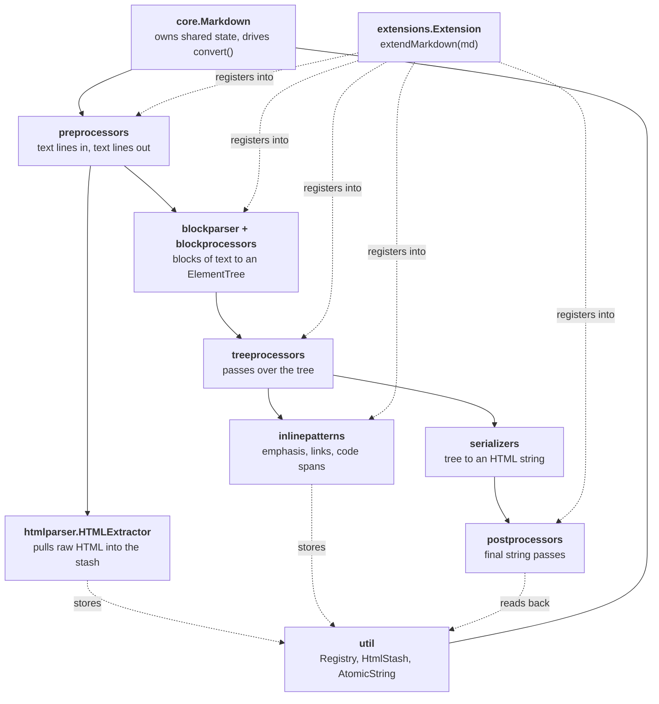

# Python-Markdown — Architecture

**Repository:** https://github.com/Python-Markdown/markdown · **Pinned commit:** `3f2c5510bd8d64a73ec18342f740371bcde9b20c` (version 3.11.2)

---

## 1. Overview

Python-Markdown turns Markdown text into HTML. It is a library first
(`markdown.markdown(text)`) and a CLI second (`python -m markdown`). The core has
no required third-party dependencies.

Conversion is a fixed five-phase pipeline. Text goes in, an `ElementTree` is built
in the middle, and HTML text comes out. Each phase is an ordered, named collection
that extensions insert into — that collection is the whole extension mechanism.



### The eight components

| Component | What it does | Who calls it |
|---|---|---|
| **`core.Markdown`** | Builds the five registries, holds the shared state every phase reads and writes, and runs `convert()`. | The user, or `markdown.markdown()`. |
| **`util`** | `Registry` (the priority list), `HtmlStash` (holds extracted raw HTML), `AtomicString` (marks finished text), `Processor` base class. | Everything. |
| **`preprocessors`** | Line-level work before parsing: whitespace normalisation, and extracting raw HTML via `HTMLExtractor`. | `core`. |
| **`htmlparser.HTMLExtractor`** | Finds raw HTML in the source, puts it in the stash, leaves a placeholder string behind. A private, monkeypatched copy of the stdlib `html.parser`. | `preprocessors`. Calls back into `core.Markdown.is_block_level`. |
| **`blockparser` + `blockprocessors`** | Splits text at blank lines and asks each processor "is this block yours?" in priority order. Builds the `ElementTree`. Recurses for nested content. | `core`. |
| **`treeprocessors`** | Passes over the finished tree. The one named `inline` runs every inline pattern; `prettify` adds newlines; `unescape` restores backslash escapes. | `core`. |
| **`inlinepatterns`** | Everything inside a line: code spans, links, images, raw inline HTML, and `DelimiterProcessor`, the emphasis engine. | The `inline` treeprocessor. |
| **`serializers` + `postprocessors`** | Writes the tree to a string (iteratively, not recursively), then puts the stashed raw HTML back by string substitution. | `core`. |

### Priorities

Each registry sorts by a number, highest first. Ties break by registration order,
so two extensions at the same priority behave differently depending on the order
the user lists them. The defaults:

```
preprocessors    normalize_whitespace 30 · html_block 20
blockprocessors  empty 100 · indent 90 · code 80 · hashheader 70 · setextheader 60
                 hr 50 · olist 40 · ulist 30 · quote 20 · reference 15 · paragraph 10
inlinepatterns   backtick 190 · escape 180 · reference 170 · link 160 · image_link 150
                 image_reference 140 · short_reference 130 · short_image_ref 125
                 autolink 120 · automail 110 · linebreak 100 · html 90 · entity 80
                 em_strong 60
treeprocessors   inline 20 · prettify 10 · unescape 0
postprocessors   raw_html 30 · amp_substitute 20
```

Extensions slot into the gaps. These numbers are effectively a public API: the
eighteen bundled extensions and every third-party one pick their priority
relative to these, so changing a default silently reorders other people's code.

### Shared state

The five phases are decoupled in sequence but coupled through one object. The
`Markdown` instance carries `htmlStash` (extracted HTML, addressed by positional
index inside a placeholder string), `references` (link definitions, written in
phase 2 and read in phase 3), `block_level_elements` (one list, read by four
different consumers across three phases), `ESCAPED_CHARS`, `registeredExtensions`,
and `delimiters`. `convert()` does **not** reset any of it; `reset()` is the
caller's job between documents.

---

## 2. Architecture Decisions

### ADR-001: Ordered priority registries as the single extension mechanism

- **Status:** Verified. The `Registry` docstring documents the priority and
  replace-by-name semantics (`markdown/util.py:270`), and `Extension.extendMarkdown`
  is documented as the one method an extension must override
  (`markdown/extensions/__init__.py:132`).
- **Context:** Five phases each need an ordered collection that third parties can
  insert into, remove from, replace within and reorder, without subclassing the
  parser or editing core files.
- **Decision:** One `Registry` type for all five phases. Items carry a name and a
  numeric priority; higher runs first; the sort is lazy; access is by name or by
  index; registering an existing name replaces the item and re-sorts it under the
  new priority.
- **Alternatives considered:** (a) plain ordered lists with index-based insertion —
  brittle, because any extension inserting earlier shifts every later index;
  (b) an explicit dependency graph ("run after X") — more precise, but needs cycle
  detection and a resolver; (c) fixed phase classes with subclass hooks — closes
  the system to third parties.
- **Consequences:** Extensions compose without knowing about each other, at the
  price of the priority numbers becoming a public API. Ties resolve by
  registration order, so behaviour depends on the user's extension list order.
  Nothing validates that a chosen priority sits on the correct side of a
  dependency, so an ordering mistake shows up as wrong output rather than as an
  error.

### ADR-002: `ElementTree` in the middle, with placeholder stashing for raw HTML

- **Status:** Verified. `Markdown.convert` documents the five steps
  (`markdown/core.py:322`), and `HtmlStash` exists to "stash HTML objects that we
  extract in the beginning and replace with place-holders" (`markdown/util.py:213`).
- **Context:** A Markdown document may contain arbitrary raw HTML. It must not be
  re-parsed as Markdown, but it must reappear verbatim. A tree is wanted for
  structural manipulation, yet arbitrary raw HTML cannot always be parsed into a
  well-formed tree.
- **Decision:** Parse blocks into an `ElementTree`. Extract raw HTML in a
  preprocessor into `HtmlStash`, leaving an opaque sentinel string in the text.
  Substitute the HTML back in a postprocessor, after serialization.
- **Alternatives considered:** (a) pure string and regex transformation, like the
  original Perl Markdown — no structural extension point; (b) parsing raw HTML
  into real tree nodes — fails on the malformed and partial HTML that Markdown
  documents routinely contain; (c) a custom AST — more control, but loses the
  stdlib serializer and every extension author's existing knowledge.
- **Consequences:** Extensions get a real tree. The costs: raw HTML is invisible
  during the tree phase, so a treeprocessor cannot inspect it; the placeholder
  index is positional, so anything that removes a stash entry must keep the
  indices stable; and the pipeline carries several sentinel formats that any
  text-rewriting code must leave byte-for-byte intact. The document wrapper is
  likewise stripped by string arithmetic on the serialized output, which breaks if
  the root element ever gains an attribute.

### ADR-003: Vendor a private, monkeypatched copy of `html.parser`

- **Status:** Verified. The module docstring states it "imports a copy of
  `html.parser.HTMLParser` and modifies it heavily through monkey-patches. A copy
  is imported rather than the module being directly imported as this ensures that
  the user can import and use the unmodified library for their own needs"
  (`markdown/htmlparser.py:20-24`).
- **Context:** Markdown's HTML-block rules differ from the HTML5 spec — `</>` must
  survive as data, processing instructions must close only with `?>`, entity
  references need a trailing semicolon, backticks must not be accepted inside tag
  names. The project also wants zero required dependencies.
- **Decision:** Load a private copy of the stdlib module, overwrite its
  module-level regexes and several methods, and subclass it as `HTMLExtractor`.
  Reimplement `parse_starttag` in full, because `__starttag_text` is name-mangled
  in the base class and cannot be reached from a subclass.
- **Alternatives considered:** (a) depend on `html5lib`, `lxml` or
  `beautifulsoup4` — breaks the zero-dependency goal and still would not match
  Markdown's block rules; (b) monkeypatch the real `html.parser` in place — would
  corrupt the stdlib for the whole process, which the docstring explicitly
  rejects; (c) hand-write a tokenizer — large, and would drift from stdlib fixes.
- **Consequences:** No runtime dependency, and user code importing `html.parser`
  is unaffected. The cost is tight coupling to CPython internals: the subclass
  reimplements private methods, carries workarounds for named CPython bugs, and
  must be re-validated on each new Python release.

---

## 3. Constraints

Rules a developer should not break. None of these is enforced by a type or an
assertion — breaking any of them produces wrong output, not an error.

1. **Register through `Registry.register(item, name, priority)`, and never
   register a second processor for something the core already owns.** Never mutate
   `_data` or `_priority`, and never keep a parallel list. Registration is not a
   plain append: registering an existing name replaces the item and re-sorts it
   under the *new* priority rather than keeping the old slot. Some core processors
   also publish themselves on the `Markdown` instance from their own constructor.
   `*` and `_` are both handled by one `DelimiterProcessor` registered as
   `em_strong`, which sets `md.delimiters = self`; registering a second one
   overwrites that back-reference, so `reset()` and any extension that extends
   emphasis then operate on the wrong object, while ordinary output still looks
   correct. Extend the existing instance instead.
   *Seen in:* `markdown/util.py` (`Registry.register`, line 362);
   `markdown/inlinepatterns.py` (`md.delimiters = self`, line 637; the `add()`
   call that depends on it, line 94); the correct way to extend it in
   `markdown/extensions/legacy_em.py:33`.

2. **A block processor that pops a block and then declines the match must push the
   block back and return `False`.** The parser treats a `False` return exactly like
   a failed `test()` and falls through to the next processor, so an unrestored
   block is silently dropped from the document.
   *Seen in:* `markdown/blockparser.py` (the `is not False` check, line 158); the
   correct pattern is in `markdown/blockprocessors.py` (`ReferenceProcessor.run`,
   line 603).

3. **Text wrapped in `util.AtomicString` must stay an `AtomicString`.** It is the
   only marker that stops inline re-parsing, and it is a `str` subclass, so any
   `+`, `.strip()` or `.format()` silently downgrades it to `str` and re-enables
   parsing. Re-wrap after any string operation.
   *Seen in:* `markdown/util.py` (class definition, line 186); the guard at
   `markdown/treeprocessors.py:132` and the deliberate re-wrap at
   `markdown/treeprocessors.py:244-247`.

4. **Treat anything a processor copied from the `Markdown` instance at
   construction as a snapshot, not a live value.** `BlockProcessor.__init__` copies
   `tab_length`, and the indent-sensitive processors compile regexes from it in
   their own constructors, including the subclasses that extensions add. Assigning
   to `md.tab_length` afterwards changes the attribute but reaches none of them.
   *Seen in:* `markdown/blockprocessors.py` (the copy at line 76; a compiled regex
   depending on it at line 172).

5. **A key written during one phase and read during another must be normalised
   the same way on both sides.** Several features store something under a key
   taken from document text in an early phase, then look it up from document
   text in a later phase. Between those two points the inline phase replaces
   every construct it matches with an opaque placeholder and keeps only the
   rendered element, so the text a later phase sees is not the text an earlier
   phase stored and the original spelling is no longer recoverable from the
   placeholder alone. Whenever a lookup can be reached from both sides of the
   inline phase, make the two sides agree explicitly; do not assume the text is
   unchanged, and do not repair it by moving processors past one another, which
   changes what every other construct nests inside.
   *Seen in:* the placeholder machinery in `markdown/treeprocessors.py` and the
   reference store on the `Markdown` instance.
